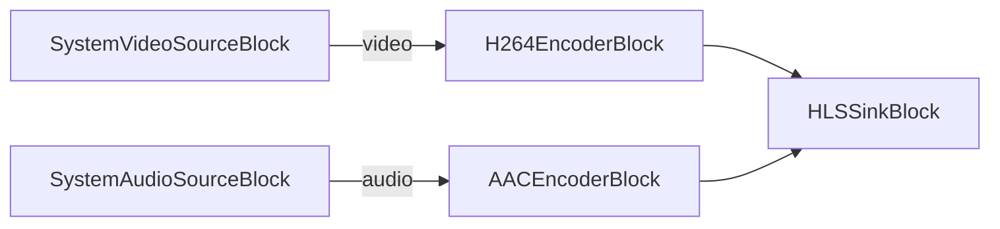

# Media Blocks SDK .Net - HLS Streamer (C#/Console)

This application captures video and audio from the system camera and microphone and streams them using the HLS (HTTP Live Streaming) protocol. The demo includes a built-in HTTP server for easy testing.

## Features

* Captures video from a webcam
* Captures audio from a microphone
* Encodes using H.264 and AAC
* Creates HLS segments with .m3u8 playlist
* Includes built-in HTTP server on port 8088
* Automatically manages segment files

## Used media blocks

* `SystemVideoSourceBlock` - Webcam capture
* `SystemAudioSourceBlock` - Microphone capture
* `H264EncoderBlock` - H.264/AVC video encoding
* `AACEncoderBlock` - AAC audio encoding
* `HLSSinkBlock` - HLS streaming output

## How to use

1. Run the application
2. Wait a few seconds for the first HLS segment to be created
3. Open http://localhost:8088/index.htm in your web browser
4. The video should start playing automatically
5. Press Enter in the console to stop streaming

## Configuration

You can modify the HLS settings in `Program.cs`:

* `TargetDuration` - Duration of each segment (default: 5 seconds)
* `MaxFiles` - Maximum number of segment files to keep (default: 10)
* `PlaylistLength` - Number of segments in playlist (default: 5)
* `Custom_HTTP_Server_Port` - HTTP server port (default: 8088)

## Pipeline

## Supported frameworks

* .Net 4.7.2
* .Net Core 3.1
* .Net 5
* .Net 6
* .Net 7
* .Net 8
* .Net 9
* .Net 10

---

[Visit the product page.](https://www.visioforge.com/media-blocks-sdk)
