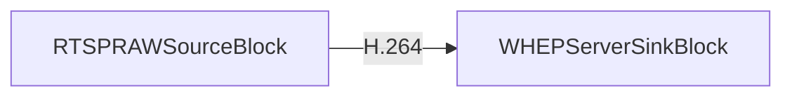

# Media Blocks SDK .Net - RTSP WHEP Camera Grid (C#/Console, Windows, macOS, Linux)

This console application shows IP cameras live in a web browser. Pass each camera's RTSP URL, open the grid page it prints, and every camera plays in the browser over WebRTC (WHEP), with the camera's own H.264 sent as it is - no decoding, no encoding, almost no CPU per camera.

```
RTSPWHEPCameraGrid [--port 8080] [--login user --password pass] rtsp://camera1 [rtsp://camera2 ...]
```

Each camera gets its own WHEP server (`WHEPServerSinkBlock`) on `127.0.0.1:9100`, `:9101` and so on. The app also serves the grid page and forwards `/cam/N/whep/...` to camera N's server, so the page and the WHEP requests share one origin: the WHEP server sends no CORS headers.

The page is served on `localhost` only. To show the cameras on other computers, put a reverse proxy (nginx, IIS, Caddy) in front of it, forward the same paths and set the `Host` header to `localhost:<port>`. Receiving WebRTC needs no HTTPS, so plain `http://` works on the local network.

Most browsers cannot play H.265 over WebRTC: use the camera's H.264 stream.

## Platforms

* Windows x64 - `VisioForge.CrossPlatform.Core.Windows.Adds.x64`
* macOS - `VisioForge.CrossPlatform.Core.macOS.Adds`
* Linux x64 / arm64 (Debian 12, Ubuntu 24.04 and later) - `VisioForge.CrossPlatform.Core.Linux.Adds.x64` / `.arm64`, plus the distribution's GStreamer with `gstreamer1.0-plugins-bad` and `gstreamer1.0-nice`

## Used media blocks

* `RTSPRAWSourceBlock` - Encoded H.264 from the camera, without decoding
* `WHEPServerSinkBlock` - WHEP server, sends the H.264 to every browser without re-encoding

## Pipeline



One such pair per camera.

## Supported frameworks

* .Net 10 (Windows, macOS), .Net 8 (Linux)

---

[Visit the product page.](https://www.visioforge.com/media-blocks-sdk)
