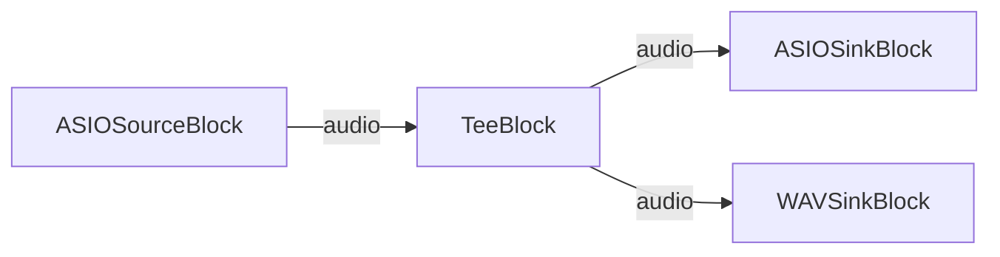

# Media Blocks SDK .Net - ASIO Audio Demo (C#/WPF)

Esta aplicación envía una entrada ASIO a una salida ASIO con los canales y el tamaño de búfer elegidos, con grabación opcional a WAV.

## Bloques de medios utilizados

* `ASIOSourceBlock` - Captura de audio ASIO
* `TeeBlock` - División de flujo de audio
* `ASIOSinkBlock` - Reproducción de audio ASIO
* `WAVSinkBlock` - Grabación de archivo WAV

## Pipeline

## Requisitos

Un driver ASIO instalado: el driver propio de la interfaz de audio, o FlexASIO / ASIO4ALL.

## Frameworks soportados

* .Net 10

---

[Visit the product page.](https://www.visioforge.com/media-blocks-sdk)
