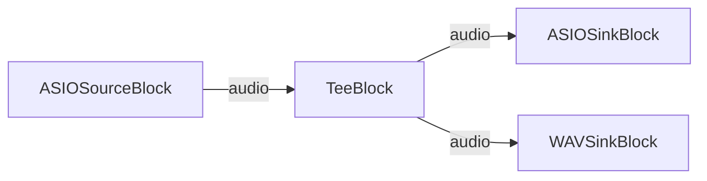

# Media Blocks SDK .Net - ASIO Audio Demo (C#/WPF)

This application routes an ASIO input to an ASIO output with selected channels and buffer size, with optional recording to WAV.

## Used media blocks

* `ASIOSourceBlock` - ASIO audio capture
* `TeeBlock` - Audio stream splitting
* `ASIOSinkBlock` - ASIO audio playback
* `WAVSinkBlock` - WAV file recording

## Pipeline

## Requirements

An installed ASIO driver: the audio interface's own driver, or FlexASIO / ASIO4ALL.

## Supported frameworks

* .Net 10

---

[Visit the product page.](https://www.visioforge.com/media-blocks-sdk)
