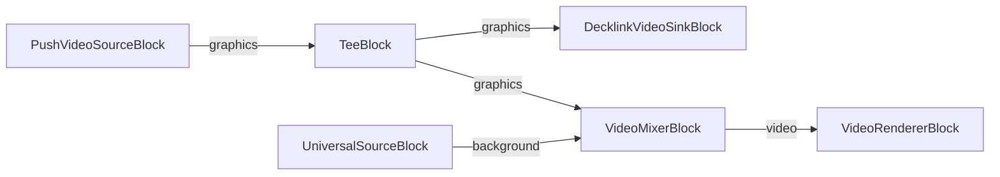

# Media Blocks SDK .Net - Decklink Fill-Key Demo (C#/WPF)

This application demonstrates real-time broadcast graphics with Decklink Fill+Key output, combining WPF-generated graphics with video backgrounds for professional broadcast overlays.

## Used media blocks

* `PushVideoSourceBlock` - Graphics frame push source
* `UniversalSourceBlock` - Video file background source
* `VideoMixerBlock` - Video compositing
* `TeeBlock` - Stream splitting for preview and output
* `VideoRendererBlock` - Real-time video preview
* `DecklinkVideoSinkBlock` - Decklink output with the keyer

## Pipeline

With the keyer on (shown above), the card gets the graphics alone and the background reaches only the preview. With the keyer off, the tee sits after the mixer, and the card and the preview get the same mixed picture.

## Fill and Key

With the External keyer, one `DecklinkVideoSinkBlock` is enough: the card outputs the Fill and the Key (alpha as a greyscale matte) on the selected device's two paired SDI connectors. The Internal keyer keys the graphics over the card's own input instead. Both key on the alpha channel, so the demo sends ARGB 8-bit whenever the keyer is on. Keying needs the card's one-sub-device full-duplex profile, so the demo sets `Profile = DecklinkProfileID.OneSubDeviceFull`; the card keeps that profile after the demo exits, and the pair's second device stays unavailable until another profile is selected in Desktop Video Setup. Select the pair's first device - on a DeckLink Duo 2, DeckLink Duo (1) or (2); a Decklink input background cannot use the pair's second device. With the keyer on, the card gets the graphics alone, and a selected background is mixed into the preview only: an opaque background mixed in before the card would leave no alpha to key on.

## Supported frameworks

* .Net 4.7.2
* .Net Core 3.1
* .Net 5
* .Net 6
* .Net 7
* .Net 8
* .Net 9
* .Net 10

---

[Visit the product page.](https://www.visioforge.com/media-blocks-sdk)
