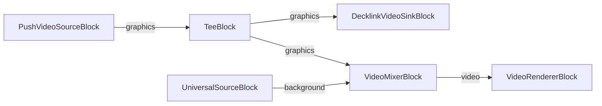

# Media Blocks SDK .Net - Decklink Fill-Key Demo (C#/WPF)

Esta aplicación demuestra gráficos de transmisión en tiempo real con salida Decklink Fill+Key, combinando gráficos generados por WPF con fondos de video para superposiciones de transmisión profesional.

## Bloques de medios utilizados

* `PushVideoSourceBlock` - Fuente de fotogramas gráficos
* `UniversalSourceBlock` - Fuente de video de fondo
* `VideoMixerBlock` - Composición de video
* `TeeBlock` - División de flujo para vista previa y salida
* `VideoRendererBlock` - Vista previa de video en tiempo real
* `DecklinkVideoSinkBlock` - Salida Decklink con el keyer

## Pipeline

Con el keyer activado (arriba), la tarjeta recibe solo los gráficos y el fondo llega únicamente a la vista previa. Con el keyer desactivado, el tee va después del mezclador, y la tarjeta y la vista previa reciben la misma imagen mezclada.

## Fill y Key

Con el keyer externo basta un único `DecklinkVideoSinkBlock`: la tarjeta emite el Fill y el Key (el alfa como máscara en escala de grises) por los dos conectores SDI emparejados del dispositivo seleccionado. El keyer interno, en cambio, superpone los gráficos sobre la entrada de la propia tarjeta. Ambos usan el canal alfa, por lo que la demo envía ARGB 8-bit siempre que el keyer está activado. El keying necesita el perfil de un subdispositivo full-duplex de la tarjeta, por lo que la demo establece `Profile = DecklinkProfileID.OneSubDeviceFull`; la tarjeta conserva ese perfil al cerrar la demo, y el segundo dispositivo del par no está disponible hasta que se elija otro perfil en Desktop Video Setup. Seleccione el primer dispositivo del par: en una DeckLink Duo 2, DeckLink Duo (1) o (2); un fondo de entrada Decklink no puede usar el segundo dispositivo del par. Con el keyer activado, la tarjeta recibe solo los gráficos, y el fondo seleccionado se mezcla únicamente en la vista previa: un fondo opaco mezclado antes de la tarjeta no dejaría alfa con la que hacer el keying.

## Frameworks soportados

* .Net 4.7.2
* .Net Core 3.1
* .Net 5
* .Net 6
* .Net 7
* .Net 8
* .Net 9
* .Net 10

---

[Visit the product page.](https://www.visioforge.com/media-blocks-sdk)
