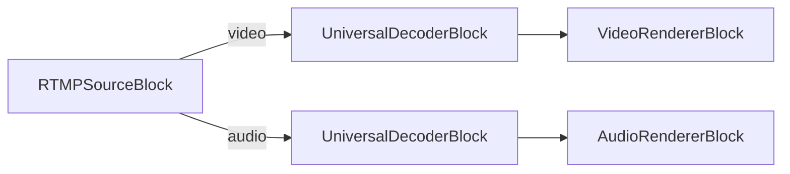

# Media Blocks SDK .Net - RTMP Source Demo (C#/WPF)

This application plays a live RTMP stream (video and audio) from a media server such as MediaMTX, Nginx-RTMP or Wowza.

## Used media blocks

* `RTMPSourceBlock` - RTMP stream input (compressed video and audio)
* `UniversalDecoderBlock` - video (H.264, H.265) and audio (AAC, MP3) decoding
* `VideoRendererBlock` - Real-time video display
* `AudioRendererBlock` - Real-time audio playback on the selected output, with volume control

## Pipeline



## Testing

Publish a file to your RTMP server with FFmpeg, then enter the same URL in the demo and press Start:

```
ffmpeg -re -stream_loop -1 -i video.mp4 -c copy -f flv rtmp://127.0.0.1:1935/live/stream
```

## Supported frameworks

* .Net 4.7.2
* .Net 5
* .Net 6
* .Net 7
* .Net 8
* .Net 9
* .Net 10

---

[Visit the product page.](https://www.visioforge.com/media-blocks-sdk)
