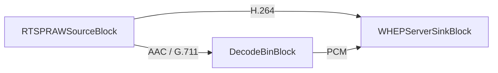

# Media Blocks SDK .Net - RTSP WHEP Camera Grid Demo (C#/WPF)

This application shows IP cameras live in a web browser. Add each camera by its RTSP URL, press **Start** and open the grid page: every camera plays in the browser over WebRTC (WHEP), with the camera's own H.264 sent as it is - no decoding, no encoding, almost no CPU per camera - and the camera's audio, when it has any, encoded to Opus. The page starts muted: unmute a tile with its controls. Clear **Camera audio** to leave the audio of every camera out: when a camera's audio codec has no decoder, which stops the whole grid, or a camera lists audio and sends none, which leaves that camera's tile empty.

Each camera gets its own WHEP server (`WHEPServerSinkBlock`). The app also serves the grid page and forwards `/cam/N/whep/...` to camera N's server, so the page and the WHEP requests share one origin: the WHEP server sends no CORS headers. Any other WHEP player can use the per-camera URLs shown in the list.

The page is served on `localhost` only, which needs no administrator rights. To show the cameras on other computers, put a reverse proxy (nginx, IIS, Caddy) in front of it, forward the same paths and set the `Host` header to `localhost:<port>`: the page server answers no other host name. Receiving WebRTC needs no HTTPS, so plain `http://` works on the local network.

Chrome and Edge played a camera's 1080p Main profile H.264 in our tests; a browser whose WebRTC decoder takes only constrained baseline shows an empty tile for a Main or High profile camera. Most browsers cannot play H.265 over WebRTC: use the camera's H.264 stream.

## Used media blocks

* `RTSPRAWSourceBlock` - Encoded H.264 from the camera, without decoding, and its encoded audio
* `DecodeBinBlock` - Decodes the camera's AAC or G.711
* `WHEPServerSinkBlock` - WHEP server, sends the H.264 to every browser without re-encoding and encodes the audio to Opus

## Pipeline

One such chain per camera; the audio part only for a camera that sends audio.

## Supported frameworks

* .Net 10

---

[Visit the product page.](https://www.visioforge.com/media-blocks-sdk)
