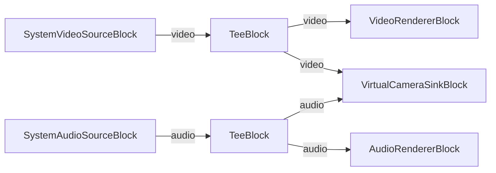

# Media Blocks SDK .Net - Virtual Camera Demo (C#/WPF)

Esta aplicación transmite video de la webcam a VisioForge Virtual Camera y audio del micrófono a VisioForge Virtual Audio Card a través de memoria compartida. Zoom, OBS y los navegadores ven la cámara como una webcam, y las aplicaciones DirectShow también ven la Virtual Audio Card como un micrófono.

## Bloques de medios utilizados

* `SystemVideoSourceBlock` - Captura de video de webcam
* `SystemAudioSourceBlock` - Captura de audio del micrófono
* `TeeBlock` - División de flujo para vista previa y salida de cámara virtual
* `VideoRendererBlock` - Vista previa de video en tiempo real
* `AudioRendererBlock` - Vista previa de audio en tiempo real
* `VirtualCameraSinkBlock` - Salida de cámara virtual vía memoria compartida

## Pipeline

## Frameworks soportados

* .Net 4.7.2
* .Net Core 3.1
* .Net 5
* .Net 6
* .Net 7
* .Net 8
* .Net 9
* .Net 10

---

[Visit the product page.](https://www.visioforge.com/media-blocks-sdk)
