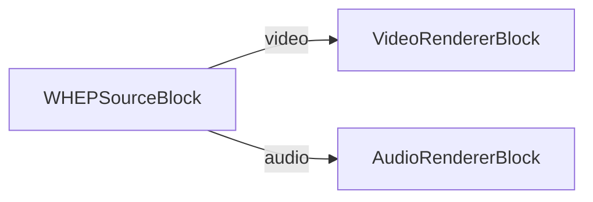

# Media Blocks SDK .Net - WHEP Player Demo (C#/WPF)

This application plays a WebRTC stream from a WHEP endpoint (MediaMTX, Janus, Cloudflare Stream and others) with sub-second latency. Enter the WHEP URL, for example `http://server:8889/mystream/whep` on MediaMTX, and press Start.

The renderers run with `IsSync = false`: every frame is shown as soon as it is decoded instead of being held for the pipeline latency. Measured from MediaMTX on a local network: about 70 ms glass to glass for H.264, 90 ms for VP8.

Clear Audio for a video-only stream: MediaMTX refuses a session that asks for audio the stream does not have.

## Used media blocks

* `WHEPSourceBlock` - WHEP (WebRTC) stream input, decoded video and audio
* `VideoRendererBlock` - Real-time video display
* `AudioRendererBlock` - Real-time audio playback

## Pipeline

## Supported frameworks

* .Net 10

---

[Visit the product page.](https://www.visioforge.com/media-blocks-sdk)
