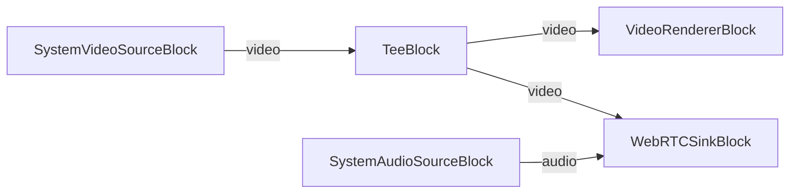

# Media Blocks SDK .Net - WebRTC Browser Streamer Demo (C#/WPF)

This application streams a camera and a microphone straight to web browsers over WebRTC, with sub-second latency and no media server. The sink block runs its own signalling server and serves the viewer page from the `wwwroot` folder: press **Start**, then open the link in Chrome, Edge, Firefox or Safari. Check **Allow viewers from other computers** to watch from another device on the same network.

## Used media blocks

* `SystemVideoSourceBlock` - Camera video capture
* `SystemAudioSourceBlock` - Microphone audio capture
* `TeeBlock` - Splits the camera to the preview and to the browsers
* `VideoRendererBlock` - Local video preview
* `WebRTCSinkBlock` - WebRTC to browsers, encoding per viewer, signalling and web server built in

## Pipeline

## Supported frameworks

* .Net 10

---

[Visit the product page.](https://www.visioforge.com/media-blocks-sdk)
