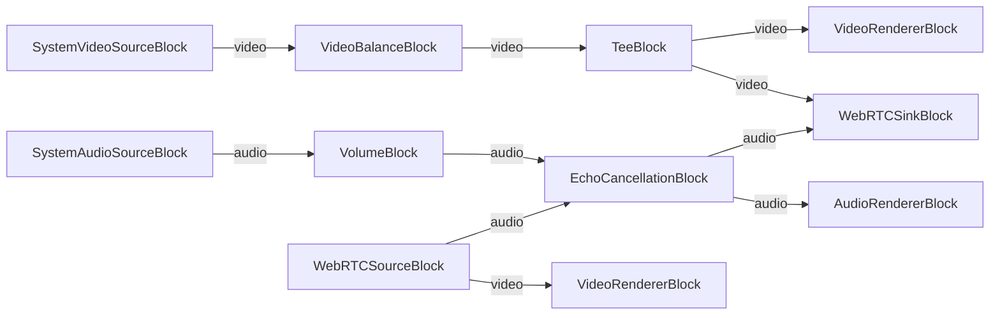

# Media Blocks SDK .Net - WebRTC Video Call Demo (C#/WPF)

Esta aplicación mantiene una videollamada bidireccional con un navegador web por WebRTC, sin servidor de medios. Envía su cámara y su micrófono al navegador y muestra y reproduce lo que el navegador le envía. El micrófono pasa por la cancelación de eco, así la voz del navegador que suena por los altavoces no vuelve a quien llama. El bloque sink ejecuta el servidor de señalización y sirve la página de llamada desde la carpeta `wwwroot`: pulse **Start**, abra el enlace en Chrome, Edge, Firefox o Safari en el mismo ordenador y pulse **Call**. **Mute** y **Camera off** funcionan durante la llamada; cuelgue en el navegador y vuelva a llamar tantas veces como quiera.

## Bloques de medios utilizados

* `SystemVideoSourceBlock` - Captura de vídeo de la cámara
* `SystemAudioSourceBlock` - Captura de audio del micrófono
* `VideoBalanceBlock` - Cámara apagada (imagen negra)
* `VolumeBlock` - Silencio del micrófono
* `EchoCancellationBlock` - Cancelación de eco, supresión de ruido y control de ganancia
* `TeeBlock` - Divide la cámara entre la vista previa y el navegador
* `VideoRendererBlock` - Vista previa local y vídeo del navegador
* `AudioRendererBlock` - Audio del navegador
* `WebRTCSinkBlock` - WebRTC hacia el navegador, con servidor de señalización y servidor web integrados
* `WebRTCSourceBlock` - WebRTC desde el navegador, espera a que la página de llamada lo llame

## Pipeline

## Llamar desde otro ordenador

Los navegadores dan a una página la cámara y el micrófono solo en `https://` o en `localhost`/`127.0.0.1`, y el servidor web integrado del sink es `http://`. Para llamar desde otro ordenador, aloje la página de llamada en su propio sitio `https://` y dé al sink un certificado (`SignallingServerCertificate`, `SignallingServerKey`) para que la página llegue al servidor de señalización por `wss://`. Después asigne `SignallingServerHost = "0.0.0.0"` y, como el servidor solo acepta entonces `wss://`, el `SignallingServer` de la fuente a `wss://127.0.0.1:<puerto>` (la fuente no comprueba el certificado). Fuera de una misma red, añada un servidor TURN a `WebRTCSinkSettings.TurnServers`, `WebRTCSourceSettings.TurnServers` y a los `iceServers` de la página.

## Frameworks soportados

* .Net 10

---

[Visit the product page.](https://www.visioforge.com/media-blocks-sdk)
