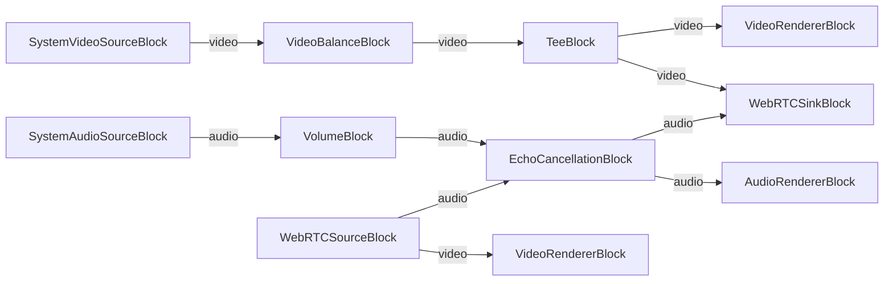

# Media Blocks SDK .Net - WebRTC Video Call Demo (C#/WPF)

This application holds a two-way video call with a web browser over WebRTC, with no media server. It sends its camera and microphone to the browser and shows and plays what the browser sends back. The microphone goes through echo cancellation, so the browser's voice from the speakers is not sent back to the caller. The sink block runs the signalling server and serves the call page from the `wwwroot` folder: press **Start**, open the link in Chrome, Edge, Firefox or Safari on the same computer and press **Call**. **Mute** and **Camera off** work during the call; hang up in the browser and call again as often as you like.

## Used media blocks

* `SystemVideoSourceBlock` - Camera video capture
* `SystemAudioSourceBlock` - Microphone audio capture
* `VideoBalanceBlock` - Camera off (a black picture)
* `VolumeBlock` - Microphone mute
* `EchoCancellationBlock` - Echo cancellation, noise suppression and gain control
* `TeeBlock` - Splits the camera to the preview and to the browser
* `VideoRendererBlock` - Local preview and the browser's video
* `AudioRendererBlock` - The browser's audio
* `WebRTCSinkBlock` - WebRTC to the browser, signalling and web server built in
* `WebRTCSourceBlock` - WebRTC from the browser, waits for the call page to call it

## Pipeline

## Calling from another computer

Browsers give a page the camera and microphone only on `https://` or on `localhost`/`127.0.0.1`, and the sink's built-in web server is `http://`. To call from another computer, host the call page on your own `https://` site and give the sink a certificate (`SignallingServerCertificate`, `SignallingServerKey`) so the page can reach the signalling server over `wss://`. Then set `SignallingServerHost` to `0.0.0.0` and, since the server then takes `wss://` only, the source's `SignallingServer` to `wss://127.0.0.1:<port>` (the source does not check the certificate). Outside one network, add a TURN server to `WebRTCSinkSettings.TurnServers`, `WebRTCSourceSettings.TurnServers` and the page's `iceServers`.

## Supported frameworks

* .Net 10

---

[Visit the product page.](https://www.visioforge.com/media-blocks-sdk)
