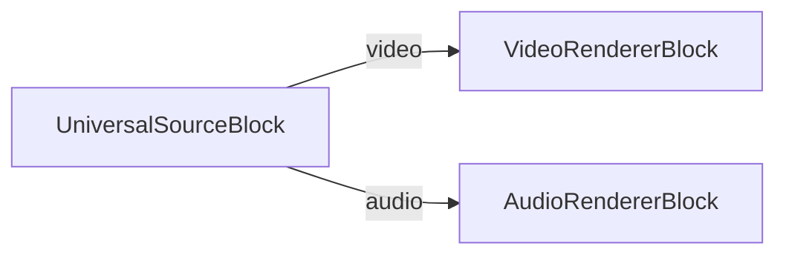

# Media Blocks SDK .Net - ARM64 Player Demo (C#/WinForms)

Un reproductor **nativo para Windows en Arm**: abre un archivo multimedia y muestra una vista previa en
vivo, con sonido cuando el archivo tiene audio. El pipeline es el mismo que el de Simple Player Demo;
solo cambia la parte de plataforma, y de eso trata este ejemplo.

## Qué es diferente en ARM64

| | |
|---|---|
| Proceso | `<PlatformTarget>ARM64</PlatformTarget>` y `<RuntimeIdentifier>win-arm64</RuntimeIdentifier>`: el apphost y el proceso en ejecución son ARM64, no x64 en emulación. La etiqueta bajo el video muestra `Process architecture: Arm64` cuando de verdad se ejecuta de forma nativa. |
| Paquetes de runtime | `VisioForge.CrossPlatform.Core.Windows.arm64` y `VisioForge.CrossPlatform.Libav.Windows.arm64`. `Libav` contiene los plugins de FFmpeg (`gst-libav`) que necesita el decodificador de archivos; `Core` no los incluye. |
| Motor | Media Blocks es la familia de motores que se ejecuta de forma nativa en Arm. Los motores clásicos de DirectShow también se ejecutan de forma nativa, en la medida de sus filtros ARM64: `VisioForge.DotNet.Core.Redist.Base.arm64` contiene los filtros base, los efectos, los mezcladores de video y audio, el renderizador WASAPI y la captura por Desktop Duplication, y `Redist.MP4.arm64` las salidas MP4/MPEG-TS/MKV/HLS con los codificadores H.264/H.265 de Media Foundation. Los filtros LAV y los codificadores y muxers DirectShow x64 heredados no tienen versión ARM64, así que una aplicación DirectShow que decodifica archivos con LAV falla en un proceso ARM64 (`0xC1` con `LAVSplitter.ax`); para esos casos, compile una aplicación x64 (`<PlatformTarget>x64</PlatformTarget>`) y deje que Windows la ejecute en emulación. |
| Funciones opcionales | NDI y los SDK de cámaras Basler, Allied Vision y Spinnaker no tienen versión ARM64. Todo lo que usa este ejemplo está incluido, también las cámaras GenICam; ElevenLabs está disponible mediante `VisioForge.CrossPlatform.ElevenLabs.Windows.arm64`. |

## Problemas conocidos de ARM64

* **`NETSDK1152`, salida de publicación duplicada.** `Core.Windows.arm64` y `Libav.Windows.arm64`
  incluían las mismas siete DLL de libav, así que `dotnet publish -r win-arm64` fallaba con *Found multiple
  publish output files with the same relative path* mientras que `dotnet build` funcionaba. Corregido en
  los paquetes: las versiones fijadas en el archivo de proyecto publican sin problemas. No fije un paquete
  ARM64 anterior a la corrección.
* **Smart App Control bloquea binarios sin firma.** En una instalación limpia de Windows 11 Arm, Smart App
  Control está activado y se niega a cargar cualquier binario sin firma Authenticode. Los archivos de los
  paquetes publicados de VisioForge están firmados, pero el EXE de su aplicación no lo está salvo que usted
  lo firme, y Smart App Control lo bloquea: la aplicación no arranca. Si compila el SDK desde el código
  fuente, sus ensamblados tampoco están firmados y el SDK informa de un "módulo no encontrado" silencioso.
  Firme el EXE y las DLL que distribuya, o desarrolle en una máquina con Smart App Control desactivado o en
  modo de evaluación.
* **`PlatformTarget=x64`.** Un proyecto copiado de los ejemplos x64 sigue compilando un proceso x64 aunque
  referencie los paquetes de runtime ARM64; entonces se ejecuta en emulación y carga las bibliotecas
  nativas x64. Los dos ajustes tienen que coincidir.

## Compilación

```powershell
dotnet build "ARM64 Player Demo.csproj" -r win-arm64
```

El resultado es `bin\Debug\net10.0-windows\win-arm64\ARM64 Player Demo.exe`. Se ejecuta solo en una
máquina Windows en Arm: un Windows x64 se niega a iniciar un ejecutable ARM64 ("This app can't run on your
PC"), así que la compilación es lo único que este ejemplo necesita de una máquina x64. Una publicación
genera la misma carpeta sin los restos de la compilación:

```powershell
dotnet publish "ARM64 Player Demo.csproj" -c Release -r win-arm64
```

## Bloques multimedia usados

* `UniversalSourceBlock`: reproducción universal de archivos multimedia
* `VideoRendererBlock`: visualización de video en tiempo real
* `AudioRendererBlock`: reproducción de audio en tiempo real

## Pipeline



## Frameworks soportados

* .Net 10

---

[Visite la página del producto.](https://www.visioforge.com/media-blocks-sdk)
