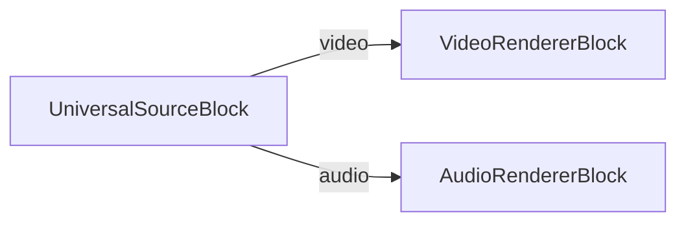

# Media Blocks SDK .Net - ARM64 Player Demo (C#/WinForms)

A native **Windows on Arm** player: it opens a media file and shows a live preview, with sound when
the file has audio. It is the same pipeline as the Simple Player Demo; only the platform part differs,
and that part is what this sample is about.

## What is different for ARM64

| | |
|---|---|
| Process | `<PlatformTarget>ARM64</PlatformTarget>` plus `<RuntimeIdentifier>win-arm64</RuntimeIdentifier>`: the apphost and the running process are ARM64, not x64 under emulation. The label under the video shows `Process architecture: Arm64` when it really runs natively. |
| Runtime packages | `VisioForge.CrossPlatform.Core.Windows.arm64` and `VisioForge.CrossPlatform.Libav.Windows.arm64`. `Libav` carries the FFmpeg (`gst-libav`) plugins the file decoder needs; `Core` does not include them. |
| Engine | Media Blocks is the engine family that runs natively on Arm. The classic DirectShow engines run natively too, as far as their ARM64 filters go: `VisioForge.DotNet.Core.Redist.Base.arm64` carries the base filters, the effects, the video and audio mixers, the WASAPI renderer and Desktop Duplication capture, and `Redist.MP4.arm64` the MP4/MPEG-TS/MKV/HLS outputs with the Media Foundation H.264/H.265 encoders. The LAV filters and the legacy x64 DirectShow encoders and muxers have no ARM64 build, so a DirectShow app that decodes files through LAV fails in an ARM64 process (`0xC1` on `LAVSplitter.ax`); for those, build an x64 app (`<PlatformTarget>x64</PlatformTarget>`) and let Windows run it under emulation. |
| Optional features | NDI, ElevenLabs and the Basler, Allied Vision and Spinnaker camera SDKs have no ARM64 build. Everything this sample uses is present, GenICam cameras included. |

## Known ARM64 traps

* **`NETSDK1152`, duplicate publish output.** `Core.Windows.arm64` and `Libav.Windows.arm64` used to ship
  the same seven libav DLLs, so `dotnet publish -r win-arm64` failed with *Found multiple publish output
  files with the same relative path* while `dotnet build` passed. Fixed in the packages: the versions
  pinned in the project file publish cleanly. Do not pin an ARM64 package older than the fix.
* **Smart App Control blocks unsigned binaries.** On a clean Windows 11 Arm install Smart App Control is
  on, and it refuses to load anything that is not Authenticode-signed. The files inside the released
  VisioForge packages are signed, but your application EXE is not unless you sign it, and Smart App Control
  then blocks it: the app does not start at all. If you build the SDK from source, its assemblies are
  unsigned too, and the SDK reports a silent "module not found" from them. Sign the EXE and the DLLs you
  ship, or develop on a machine with Smart App Control off or in evaluation mode.
* **`PlatformTarget=x64`.** A demo project copied from the x64 samples still builds an x64 process even
  though the ARM64 runtime packages are referenced; it then runs under emulation and loads the x64
  natives. Both settings have to agree.

## Build

```powershell
dotnet build "ARM64 Player Demo.csproj" -r win-arm64
```

The result is `bin\Debug\net10.0-windows\win-arm64\ARM64 Player Demo.exe`. It runs on a Windows on Arm
machine only: an x64 Windows refuses to start an ARM64 executable ("This app can't run on your PC"), so
the build itself is the only thing this sample needs from an x64 machine. A publish produces the same
folder without the build leftovers:

```powershell
dotnet publish "ARM64 Player Demo.csproj" -c Release -r win-arm64
```

## Used media blocks

* `UniversalSourceBlock` - universal media file playback
* `VideoRendererBlock` - real-time video display
* `AudioRendererBlock` - real-time audio playback

## Pipeline



## Supported frameworks

* .Net 10

---

[Visit the product page.](https://www.visioforge.com/media-blocks-sdk)
