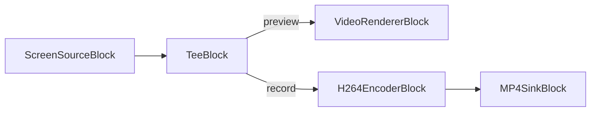

# Media Blocks SDK .Net - ScreenCapture (C#/iOS)

Esta aplicación captura la salida de audio del sistema, captura contenido de escritorio/pantalla, guarda la salida en formato MP4, divide el flujo de video para múltiples salidas.

## Bloques de medios utilizados

* `ScreenSourceBlock` - Screen capture
* `H264EncoderBlock` - H.264/AVC video encoding
* `MP4SinkBlock` - MP4 file output
* `TeeBlock` - Stream splitting
* `VideoRendererBlock` - Real-time video display

## Pipeline

## Ejecución en su dispositivo

La demo solo funciona en un iPhone o iPad real: la pantalla se captura con la extensión de difusión `ScreenCaptureExtension`, que el simulador no ejecuta. Para firmarla con su propio equipo, cambie estos identificadores a la vez:

* los bundle ID `com.visioforge.screencapture` (`ScreenCapture/Info.plist`) y `com.visioforge.screencapture.extension` (`ScreenCaptureExtension/Info.plist`, `ExtensionBundleId` en `AppDelegate.cs`); el ID de la extensión debe empezar por el ID de la aplicación;
* el App Group `group.com.visioforge.screencapture` en los dos archivos `Entitlements.plist` y `AppGroupId` en `AppDelegate.cs` y `SampleHandler.cs`. La aplicación y la extensión intercambian los fotogramas a través de este grupo, por lo que los cuatro deben coincidir.

## Frameworks soportados

* .Net 4.7.2
* .Net Core 3.1
* .Net 5
* .Net 6
* .Net 7
* .Net 8
* .Net 9
* .Net 10

---

[Visit the product page.](https://www.visioforge.com/media-blocks-sdk)
