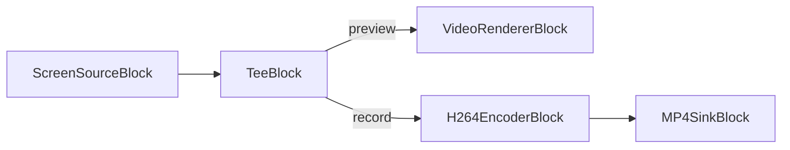

# Media Blocks SDK .Net - ScreenCapture (C#/iOS)

This application captures system audio output, captures desktop/screen content, saves output to MP4 format, splits video stream for multiple outputs.

## Used media blocks

* `ScreenSourceBlock` - Screen capture
* `H264EncoderBlock` - H.264/AVC video encoding
* `MP4SinkBlock` - MP4 file output
* `TeeBlock` - Stream splitting
* `VideoRendererBlock` - Real-time video display

## Pipeline

## Running on your device

The demo runs on a real iPhone or iPad only: the screen is captured by the `ScreenCaptureExtension` broadcast extension, which the simulator does not run. To sign it with your own team, change these identifiers together:

* the bundle IDs `com.visioforge.screencapture` (`ScreenCapture/Info.plist`) and `com.visioforge.screencapture.extension` (`ScreenCaptureExtension/Info.plist`, `ExtensionBundleId` in `AppDelegate.cs`); the extension ID must be the app ID followed by a dot and a suffix (`<app ID>.extension`);
* the App Group `group.com.visioforge.screencapture` in both `Entitlements.plist` files and `AppGroupId` in `AppDelegate.cs` and `SampleHandler.cs`. The app and the extension exchange frames through this group, so all four must match.

In your Apple Developer account, create the App Group and both App IDs with the App Groups capability, assign the group to each App ID, and create a provisioning profile for each of them.

## Supported frameworks

* .Net 10 (net10.0-ios)

---

[Visit the product page.](https://www.visioforge.com/media-blocks-sdk)
