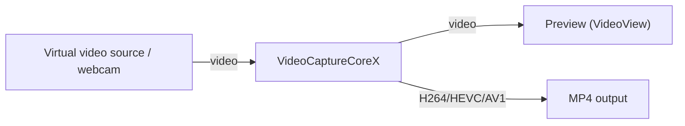

# Video Capture SDK X .Net - Encoder Concurrency Test (C#/WPF)

This application measures how many encoders your hardware can run at the same time. Each tile is a separate `VideoCaptureCoreX` instance with its own preview and its own MP4 output, so the concurrent-session limit of a hardware runtime (NVIDIA consumer drivers cap NVENC at 8 sessions, Intel QSV and AMD AMF have their own limits) shows up as the tile that refuses to start.

The source is synthetic by default, so no camera is needed. Switch the source to `Webcam` to encode real footage instead.

## How to use it

* `Codec` selects H264, HEVC or AV1; `Encoder` lists every runtime the SDK ships for that codec, not only the ones this machine has - start with your GPU vendor's entry (NVIDIA, AMD or Intel), or a CPU one if there is no GPU encoder.
* `Add pipeline` starts one more tile. `Fill to limit` keeps adding tiles until one fails to start; the result stays in the status bar, next to the live per-runtime counts, until the pipelines change.
* Every tile records to a temporary file in `%TEMP%\VFEncoderConcurrency`, deleted when the tile stops - the number of concurrent sessions is the result, not the video.

## Pipeline

One tile; the main window builds as many of them as `Fill to limit` reaches.

## Supported frameworks

* .Net 4.7.2
* .Net 5
* .Net 6
* .Net 7
* .Net 8
* .Net 9
* .Net 10

---

[Visit the product page.](https://www.visioforge.com/video-capture-sdk-net)
